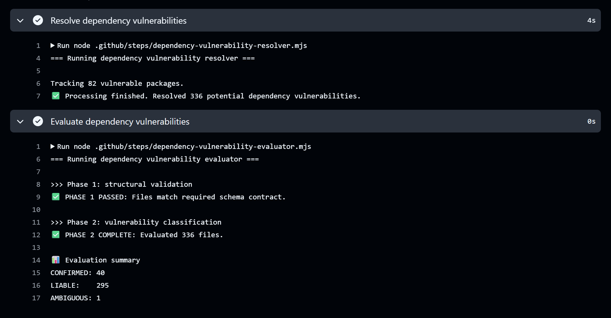
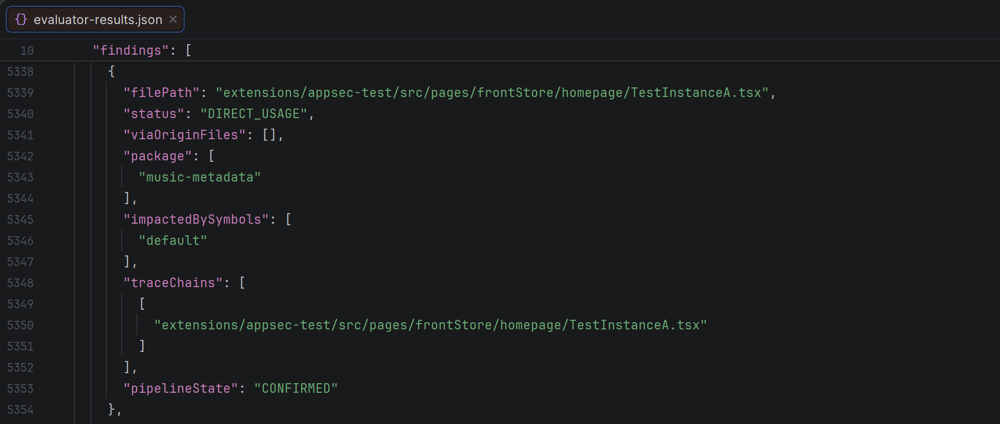
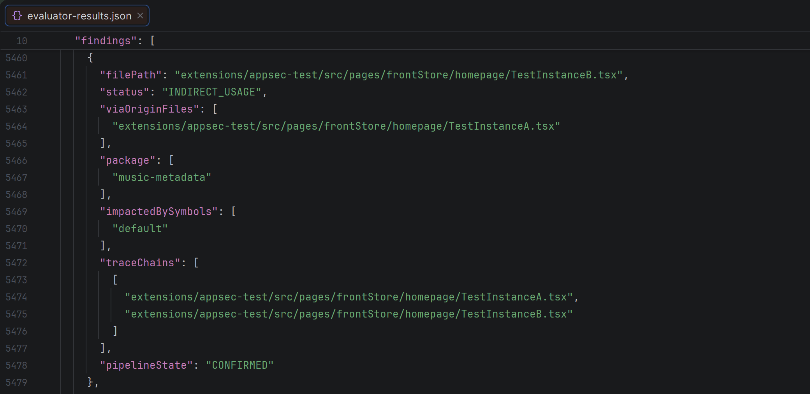
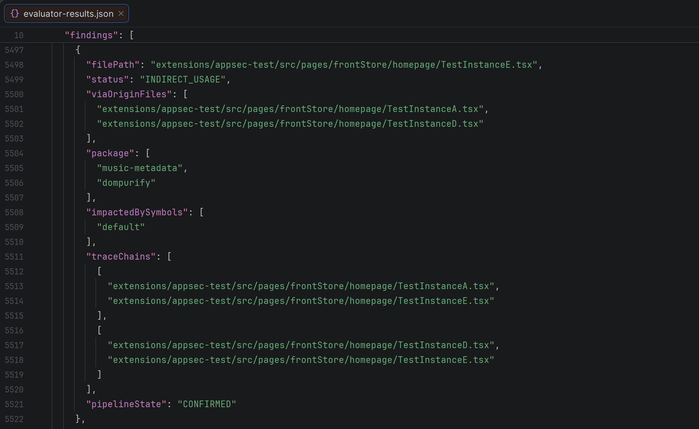

# 📓 Architecture Runbook

This document serves as the chronological engineering ledger for this project. It details key design considerations and
core implementation details without all the loaded jargon.

### Notes on wording
The use of the word "component" in this runbook primarily refers to blocks of code that can be used by other files and
do not exclusively refer to re-usable items in source code that reduce duplication in the traditional software
development sense.

---

## 📍 Phase 1: Thinking About the Result

### Caveats of Static Analysis and Reachability
Static analysis cannot resolve whether a file is actually reachable, only whether it contains evidence of exposure
should the file, or linked files, be executed.

The evaluation of a vulnerability should not only depend on whether it is executed either: a vulnerability that may be
unreachable at present may become active the moment a new execution path touches the file.

Consequently, analysing for structural risks necessitates a strategy that ensures visibility of all potential
vulnerabilities is maintained while providing the necessary precision to reduce alert fatigue.

### Leveraging the Framework
A [software bill of materials](https://www.nist.gov/itl/executive-order-14028-improving-nations-cybersecurity/software-supply-chain-security-guidance-20)
(SBOM) is the software equivalent of a shipping manifest: it contains details such as whether a file requires a
component from another and much more, with a [dependency graph](https://cheatsheetseries.owasp.org/cheatsheets/Dependency_Graph_SBOM_Cheat_Sheet.html)
acting as the underlying structure that records these relationships.

Perusing the EverShop framework for details relevant to a build-time guardrail, I found that it uses [webpack](https://webpack.js.org/concepts/dependency-graph/)
as the primary driver of its compilation process. [webpack natively builds a dependency graph](https://webpack.js.org/concepts/dependency-graph/)
but this graph does not show the granularity required for vulnerability detection. However, what it does contain is
information about which files are compiled.

### The Pipeline Output
The dependency graph enables files to receive human-readable classifications:
-   `CONFIRMED`: The file references an external module with active CVEs and the file is compiled during the build process.
-   `LIABLE`: The file references, directly or indirectly, an external module with active CVEs.
-   `AMBIGUOUS:` The file references an external module whose source is ambiguous and needs human triage to determine
    the presence of a vulnerability.

Changes in member size of each classification can then be used to provide insights on the risk profile of the project.
For example, if the number of `LIABLE` files go down but there is an equal increase in number of `CONFIRMED` files,
it indicates that a change had caused a certain number of vulnerable files, that were potentially unused, to being
compiled.

## 📍 Phase 2: Finding Potential Vulnerabilities

### The Objective
Achieve granular vulnerability mapping by identifying the components that ingest vulnerable dependencies and their
'consumers', producing reports that are low in noise without making any assumptions about reachability.

### Identifying Tainted Elements
The vulnerable packages are identified by comparing the project's dependencies against a public vulnerability database.
Application code is then scanned for direct usage of these vulnerable packages. Files with ambiguous references, that is
files where it is unknown whether it is referencing a vulnerable package, are classified as ambiguous at this stage.

To maintain precision, taint should only occur if a component has actual exposure to a vulnerable package. For example,
a file that defines themed UI components may export two different product displays. Only one of these displays may
actually use the vulnerable package.

By tracking taint at the component level rather than the file level, files and components without actual exposure are
not falsely flagged.

### Tracing Taint
To track indirect usages, all files are scanned to see if they reference a tainted component. If they do, taint is
inherited into the consumer file, tainting the consumer component.

The chains of exposure are also recorded along with whether a file is indirectly exposed to multiple vulnerable
import-to-invocation chains. For example, a menu may take multiple components from other files. If those components
independently carry taint, each chain of exposure is recorded along with the vulnerable packages from each chain.

## 📍 Phase 3: Validating Taint Chains

The result below shows the pipeline result on the base fork:

The tests below demonstrate how the ledger automatically updates should vulnerabilities be introduced during development
and how the evaluation results precisely traces the chain of taint.

<b>1. Single vulnerability test</b>

**Test**: Test instance A is placed in the app's home page. Instance A imports [vulnerability A](https://osv.dev/vulnerability/GHSA-jjpr-9cvf-cq55)
and exports a non-vulnerable interface and a separate component that uses the vulnerable dependency.

**Result**: The vulnerable dependency is successfully identified and instance A is correctly classified as
`CONFIRMED`.

<b>2. Indirect use test</b>

**Test**: Test instances B and C are placed in the app's home page. Instance B uses instance A's tainted component
whereas instance C only uses the safe interface.

**Result**: The number of vulnerable packages correctly remain the same and instance B is correctly classified as
`CONFIRMED`.

<b>3. Transitive use and multiple chain test</b>

**Test**: Test instances D and E are placed in the app's home page. Instance D imports [vulnerability B](https://osv.dev/vulnerability/GHSA-6688-9rhm-gjv2)
and exports a component that uses the vulnerable dependency. Instance E uses both instance B's tainted component and
instance D's tainted component.

**Result**: The number of vulnerable packages correctly remain the same, both instances D and E are correctly classified
as `CONFIRMED` and instance E correctly shows both vulnerable dependencies and both chains of tainted usage.

## Project Retrospective

It is a growing trend for teams and organisations to use open-source code to jump-start their development. However,
it remains an ongoing challenge to review adopted code for structural flaws.

My deep drive revealed how targeted visibility can be used to effectively monitor known risks, forming a composable
risk management strategy. Conducting an automated audit each time the codebase changes also builds a running ledger that
tracks surges in vulnerability exposure.

This project demonstrated the effectiveness of tailoring security solutions to the environment you are securing. While
some of the tools I designed here won't fit into every application, it has reinforced my ability to produce focused
guardrails that enable agile development while ensuring security is always part of the picture.